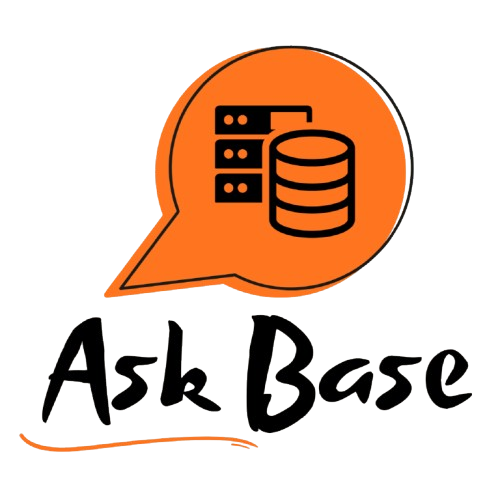
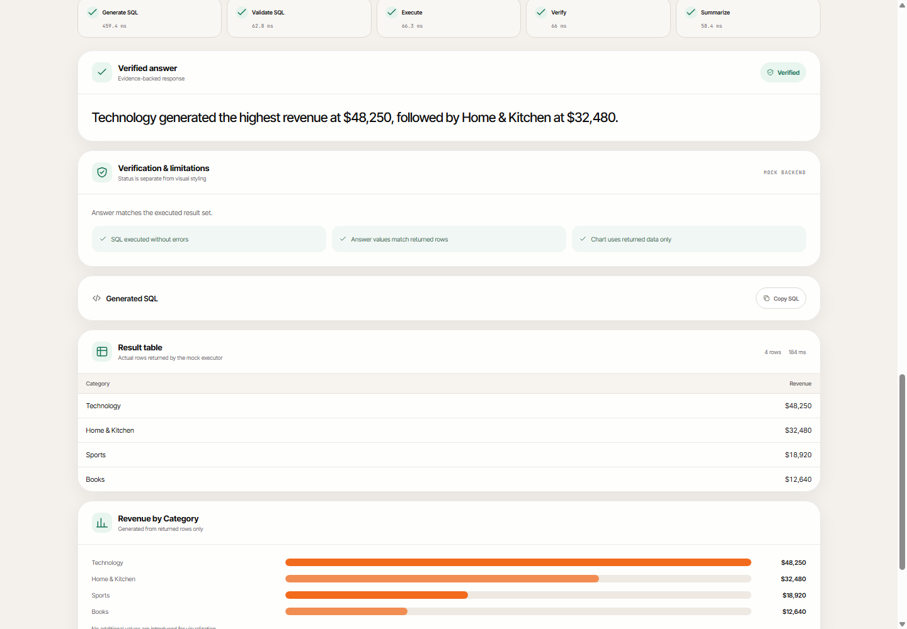
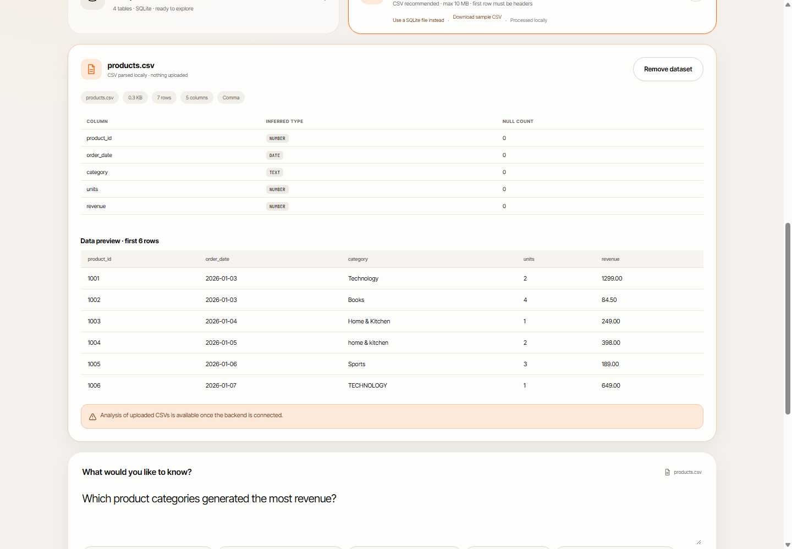
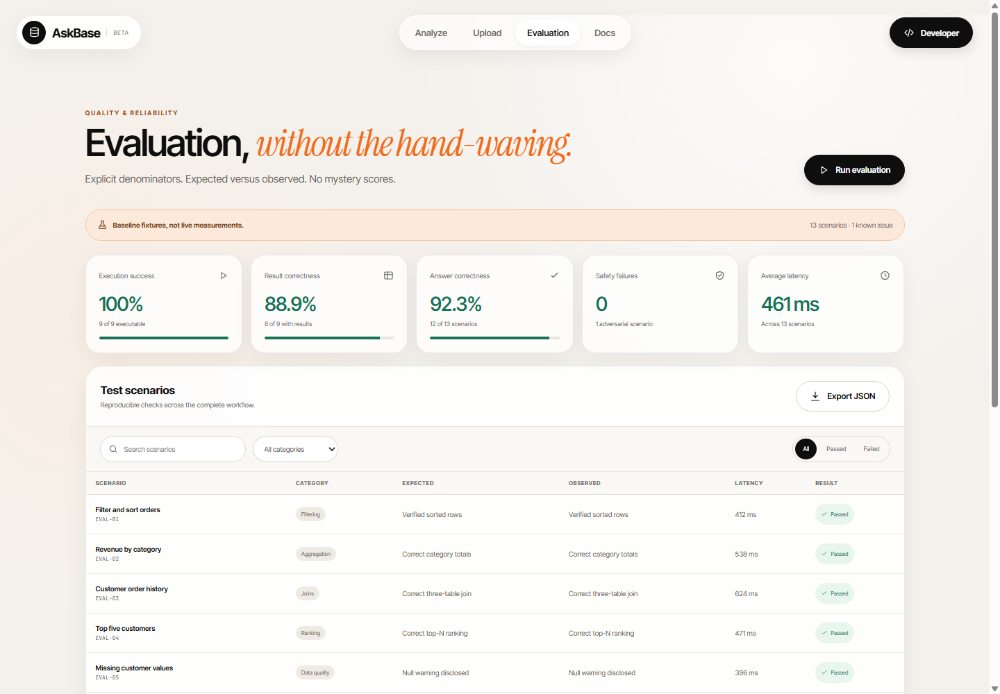
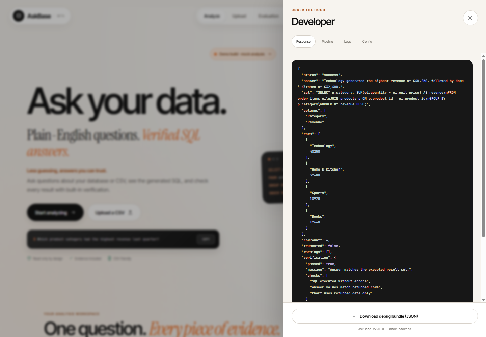
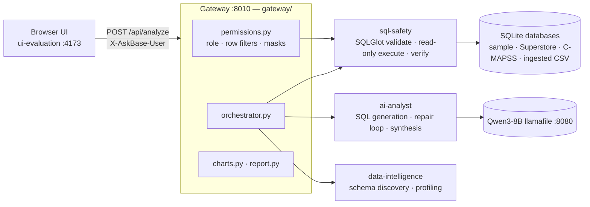

<p align="center">
  
</p>

<h1 align="center">AskBase</h1>

<p align="center">
  <strong>From questions to verified SQL insights.</strong><br>
  Ask a database a question in plain English. AskBase writes the SQL, proves it is read-only,
  runs it under row-level security, verifies the result and only then answers.
</p>

<p align="center">
  <a href="#what-it-does">What it does</a> •
  <a href="#screenshots">Screenshots</a> •
  <a href="#architecture">Architecture</a> •
  <a href="#quick-start">Quick start</a> •
  <a href="#api-and-access-control">API</a> •
  <a href="#verification">Verification</a> •
  <a href="#repository-layout">Layout</a>
</p>

<p align="center">
  
  
  
  
  
  
</p>

> **Status:** runs fully offline on a laptop (local Qwen3-8B llamafile, SQLite). It is a
> demo-grade system: identity is self-declared via a user switcher, not authenticated. Read
> [Security notes](#security-notes) before exposing it beyond `127.0.0.1`.

---

## What it does

| # | Question a user has | What AskBase does | Service |
|---|---|---|---|
| 1 | *"What tables do I even have?"* | Discovers schema, keys and data quality; suggests questions | `data-intelligence/` |
| 2 | *"Revenue by region last year?"* | Generates one SQL query, repairs it on failure, asks a clarifying question when the ask is ambiguous | `ai-analyst/` |
| 3 | *"Can this query hurt my data?"* | AST-validates (SELECT only), executes read-only with row limit and timeout, verifies the result envelope | `sql-safety/` |
| 4 | *"Who may see which rows?"* | Applies per-role row filters and column masks before execution | `gateway/permissions.py` |
| 5 | *"Show me."* | Answer, SQL, rows, chart (bar / line / pie / scatter / histogram), verified report | `ui-evaluation/` + `gateway/charts.py` |

Unverified SQL never reaches the database and never renders as a success.

## Screenshots

| Workspace — verified answer | CSV upload and profiling |
|---|---|
|  |  |
| **Evaluation dashboard** | **Developer drawer** |
|  |  |

## Architecture



**Data flow in one line:** schema → generate → validate → restrict (RLS) → read-only execute → verify → synthesize → chart.

**Failure isolation:** if the model is offline the envelope says `model_offline`; if SQL is unsafe it is
blocked as `unsafe_sql`; if verification fails the UI shows *Not verified* — never a number.

| Service | Path | Entrypoint | Owns |
|---|---|---|---|
| AI analyst | [`ai-analyst/`](ai-analyst/) | `backend/repair_loop.py` | NL → SQL, clarification, answer synthesis, prompt-injection guard, live eval harness |
| Data intelligence | [`data-intelligence/`](data-intelligence/) | `backend/schema_discovery.py` | Schema, keys, profiling, sample database |
| SQL safety | [`sql-safety/`](sql-safety/) | `backend/query_executor.py` | AST validation, read-only execution, result verification |
| UI & evaluation | [`ui-evaluation/`](ui-evaluation/) | `server.mjs` | Web app, CSV profiling, evaluation dashboard |
| Gateway | [`gateway/`](gateway/) | `server.py` | HTTP API, orchestration, RLS, charts, reports, CSV/NoSQL ingest |

## Quick start

```bat
:: one-time setup (Python 3.12+)
python -m venv .venv
.venv\Scripts\pip install -r requirements.txt
copy .env.example .env
.venv\Scripts\python.exe data-intelligence\sample_data\create_sample_db.py

:: run — three windows
start_server.bat               :: local LLM      → http://127.0.0.1:8080
start_gateway.bat              :: API gateway    → http://127.0.0.1:8010
ui-evaluation\start.bat        :: web UI         → http://127.0.0.1:4173
```

Pick a database (Sample retail, Kaggle Superstore, NASA C-MAPSS) or drop a CSV and choose
**Ingest into gateway**, then ask. Stop with `stop_gateway.bat`, `stop_server.bat` and
`ui-evaluation\stop.bat`.

> The GitHub repo name ends with a literal `.`. On Windows clone into an explicit folder:
> `git clone <url-with-trailing-dot> askbase`.

## API and access control

| Method | Path | Purpose |
|---|---|---|
| GET | `/api/health` | Liveness and model reachability |
| GET | `/api/databases` | Registered databases (`gateway/databases.json`) |
| GET | `/api/users` | User directory for the role switcher |
| GET | `/api/schema` · `/api/insights` | Role-restricted schema and profile |
| GET | `/api/chart` | Server-rendered Matplotlib PNG |
| POST | `/api/analyze` | Full pipeline → response envelope |
| POST | `/api/report` | One-click verified report (HTML, printable to PDF) |
| POST | `/api/datasets/profile` · `/api/datasets/upload` | Profile / ingest a CSV as read-only SQLite |

| Role | Rows | Columns | Writes datasets |
|---|---|---|---|
| `admin` | all | all | yes |
| `analyst` | all, max 1,000 per query | PII masked (email, phone, secrets…) | yes |
| `viewer` (default, anonymous) | filtered per database, max 200 | PII + address/postal masked | no |

Policies live in [`gateway/policies.json`](gateway/policies.json). Protected tables are rewritten as
inline views — including inside CTE bodies and subqueries — before Agent 3 executes them.

## Verification

```bat
.venv\Scripts\python.exe -m pytest tests -q                       :: gateway  — 164 tests
cd ai-analyst        && ..\.venv\Scripts\python.exe -m pytest tests -q   :: 124 tests
cd data-intelligence && ..\.venv\Scripts\python.exe -m pytest tests -q   ::  15 tests
cd sql-safety        && ..\.venv\Scripts\python.exe -m pytest tests -q   :: 308 tests
cd ui-evaluation     && node --test                                       ::  49 tests
```

Run each Python service in its own process: the services share the top-level package name
`backend/`, so one repo-wide pytest run would shadow modules (CI does the same).

What the suites pin down: no write statement ever executes; RLS wraps every read of a protected
table (CTE, subquery, UNION, alias); role names never leak into model text; hostile column names
cannot inject instructions into prompts; the UI never renders an unverified result as verified.

## Where each number comes from

| Claim | Source of truth |
|---|---|
| Test counts above | the commands in [Verification](#verification), run 2026-10-25 |
| 90% SQL on clear questions, 100% clarification on ambiguous asks, median 2.5 s (Superstore, n=28) | [`ai-analyst/REPORT.md`](ai-analyst/REPORT.md) from `ai-analyst/eval_live.py` |
| Supported SQL surface | [`sql-safety/SUPPORTED_SQL.md`](sql-safety/SUPPORTED_SQL.md) |
| Interfaces and response envelope | [`docs/INTEGRATION_CONTRACT.md`](docs/INTEGRATION_CONTRACT.md) |

The accuracy figures are generation-time checks; re-running the harness end-to-end through the gateway is still open.

## Repository layout

```text
AskBase/
├── ai-analyst/            # NL→SQL generation, repair loop, synthesis, prompt guard, live eval
├── data-intelligence/     # schema discovery, data profiling, sample database builder
├── sql-safety/            # SQLGlot validation, read-only executor, result verifier
├── ui-evaluation/         # web UI (static Node server), CSV profiling, evaluation dashboard
│   └── screenshots/       # images used in this README
├── gateway/               # HTTP API, orchestrator, RLS policies, charts, reports, ingest
├── tests/                 # gateway composition and security tests
├── docs/                  # integration contract and work reports
├── start_server.bat  stop_server.bat     # local LLM
├── start_gateway.bat stop_gateway.bat    # API gateway
├── requirements.txt  .env.example
└── README.md
```

Each service folder has its own README with its interfaces and tests.

## Security notes

- **Identity is self-declared.** The `X-AskBase-User` header is not authenticated; unknown or missing users fall back to `viewer` (fail-closed). Add real authentication before multi-user use.
- `gateway/policies.json` is edited by hand; there is no admin UI yet.
- Databases are opened `mode=ro`; every query has a row limit and timeout.
- Uploaded CSVs are stored under `gateway/uploads/` and are gitignored. `.env` is never committed.
- Bind to `127.0.0.1` only; the gateway has no TLS.

## References

- Specification: [`docs/AskBase_AI_Agent_Work_Reports.pdf`](docs/AskBase_AI_Agent_Work_Reports.pdf)
- [SQLGlot](https://github.com/tobymao/sqlglot) · [llamafile](https://github.com/Mozilla-Ocho/llamafile) · [Qwen3](https://github.com/QwenLM/Qwen3)
- Datasets: Kaggle *Superstore Sales*, NASA *C-MAPSS* turbofan degradation
