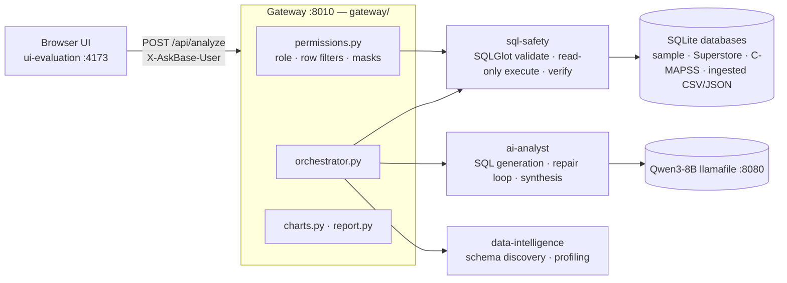
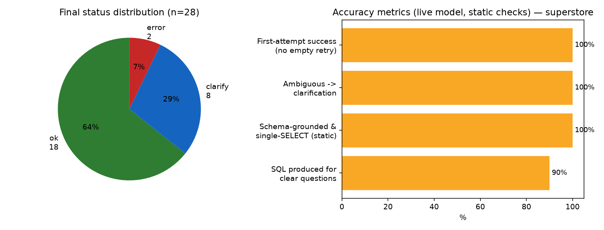

<p align="center">
  
</p>

<h1 align="center">AskBase</h1>

<p align="center">
  <strong>From questions to verified SQL insights.</strong><br>
  Ask a database a question in plain English. AskBase writes the SQL, proves it is read-only,
  runs it under row-level security, verifies the result and only then answers.
</p>

<p align="center">
  <a href="#what-it-does">What it does</a> •
  <a href="#what-makes-it-different">Uniqueness</a> •
  <a href="#architecture">Architecture</a> •
  <a href="#tech-stack">Tech stack</a> •
  <a href="#accuracy">Accuracy</a> •
  <a href="#security">Security</a> •
  <a href="#quick-start">Quick start</a> •
  <a href="#api-reference">API</a> •
  <a href="#verification">Verification</a>
</p>

<p align="center">
  
  
  
  
  
  
  
</p>

> **Status:** runs fully offline on a laptop (local Qwen3-8B llamafile, SQLite). It is a
> demo-grade system: identity is self-declared via a user switcher, not authenticated. Read
> [Known limits](#known-limits) before exposing it beyond `127.0.0.1`.

---

## Table of contents

1. [What it does](#what-it-does)
2. [What makes it different](#what-makes-it-different)
3. [Screenshots](#screenshots)
4. [Architecture](#architecture)
5. [Tech stack](#tech-stack)
6. [Accuracy](#accuracy)
7. [Security](#security)
8. [Charts and reports](#charts-and-reports)
9. [Data sources](#data-sources)
10. [Quick start](#quick-start)
11. [API reference](#api-reference)
12. [Verification](#verification)
13. [Where each number comes from](#where-each-number-comes-from)
14. [Repository layout](#repository-layout)
15. [Roadmap](#roadmap)
16. [References](#references)

---

## What it does

| # | Question a user has | What AskBase does | Service |
|---|---|---|---|
| 1 | *"What tables do I even have?"* | Discovers schema, keys and data quality; suggests questions | `data-intelligence/` |
| 2 | *"Revenue by region last year?"* | Generates one SQL query, repairs it on failure, asks a clarifying question when the ask is ambiguous | `ai-analyst/` |
| 3 | *"Can this query hurt my data?"* | AST-validates (SELECT only), executes read-only with row limit and timeout, verifies the result envelope | `sql-safety/` |
| 4 | *"Who may see which rows?"* | Applies per-role row filters and column masks before execution | `gateway/permissions.py` |
| 5 | *"Show me."* | Answer, SQL, rows, chart, one-click verified report | `ui-evaluation/` + `gateway/charts.py` |

Unverified SQL never reaches the database and never renders as a success.

## What makes it different

Most text-to-SQL demos stop at "the model produced a query". AskBase treats the model as an
untrusted author and puts the guarantees in deterministic code around it.

| Concern | Typical text-to-SQL demo | AskBase |
|---|---|---|
| Write safety | Prompt says "only SELECT" | SQLGlot AST walk rejects any write/DDL/PRAGMA/ATTACH node, plus a read-only (`mode=ro`) connection |
| Ambiguity | Guesses a time range or metric | Returns `clarification_needed` with one specific question; no SQL is generated or run |
| Unanswerable asks | Emits the "closest" query | Refuses to fabricate; names the missing column/table |
| Failed SQL | Error shown to the user | Up to 2 repair rounds feeding the database error back to the model, with SQLite dialect hints |
| Access control | None, or in the prompt | Row filters and column masks rewritten into the SQL AST (incl. CTEs, subqueries, UNIONs) before execution |
| Prompt injection via data | Column names pasted into prompt | Schema text fenced as `<untrusted_data>`, instruction-like spans redacted, invisible/bidi chars stripped |
| Result honesty | Any output = answer | Envelope verification; the UI labels results *Structure-checked* and never shows numbers for a failed check |
| Privacy | Hosted LLM API | Local Qwen3-8B llamafile; no data leaves the machine |
| Data inputs | One fixed database | Registered SQLite DBs, uploaded CSVs and JSON document collections (NoSQL via TinyDB) |

## Screenshots

| Workspace — verified answer | CSV upload and profiling |
|---|---|
|  |  |
| **Evaluation dashboard** | **Developer drawer** |
|  |  |

## Architecture



**Pipeline, step by step**

1. **Schema** — `data-intelligence` discovers tables, columns, keys and profiles.
2. **Restrict** — the gateway removes masked columns from the schema the model sees for the caller's role.
3. **Generate** — `ai-analyst` asks the local model for one SQLite `SELECT` (or a clarifying question).
4. **Repair** — on a validation or execution error the error is fed back, at most 2 rounds.
5. **Validate** — `sql-safety` parses with SQLGlot and rejects anything that is not a pure read.
6. **RLS rewrite** — protected tables are replaced by filtered, masked inline views.
7. **Execute** — read-only connection, row limit, 5 s timeout.
8. **Verify** — the result envelope is checked for internal consistency.
9. **Synthesize** — the model writes the answer from the returned rows only.
10. **Chart** — a Matplotlib chart is chosen from the result shape and the prompt.

**Failure isolation:** model offline → `model_offline`; unsafe SQL → `unsafe_sql`; verification
failure → *Not verified*, with no numbers shown.

| Service | Path | Entrypoint | Owns |
|---|---|---|---|
| AI analyst | [`ai-analyst/`](ai-analyst/) | `backend/repair_loop.py` | NL → SQL, clarification, answer synthesis, prompt-injection guard, live eval harness |
| Data intelligence | [`data-intelligence/`](data-intelligence/) | `backend/schema_discovery.py` | Schema, keys, profiling, sample database |
| SQL safety | [`sql-safety/`](sql-safety/) | `backend/query_executor.py` | AST validation, read-only execution, result verification |
| UI & evaluation | [`ui-evaluation/`](ui-evaluation/) | `server.mjs` | Web app, CSV profiling, evaluation dashboard |
| Gateway | [`gateway/`](gateway/) | `server.py` | HTTP API, orchestration, RLS, charts, reports, CSV/NoSQL ingest |

## Tech stack

| Layer | Technology | Why |
|---|---|---|
| Language model | **Qwen3-8B** (Q4_K_M GGUF) served by **llamafile 0.10.5**, `-c 4096 -ngl 99` | Runs on a 6 GB laptop GPU; OpenAI-compatible API; fully offline |
| Prompting | `/no_think` mode, JSON-only responses, SQLite dialect cheat-sheet | Removed empty completions; median latency ~2.8 s |
| SQL parsing & safety | **SQLGlot ≥ 30** | Dialect-aware AST for validation and RLS rewriting |
| Database | **SQLite** (stdlib `sqlite3`, `mode=ro` URIs) | Zero-install, read-only by construction |
| Document store | **TinyDB ≥ 4.8** | JSON/NoSQL ingest, flattened into queryable SQLite tables |
| Charts | **Matplotlib ≥ 3.8** (Agg backend) | Server-rendered PNGs, no JS charting dependency |
| Gateway | Python stdlib `http.server` | No framework to configure or patch |
| HTTP client / config | `requests ≥ 2.31`, `python-dotenv ≥ 1.0` | LLM calls, `.env` loading |
| Frontend | Vanilla JavaScript ES modules, HTML, CSS; static Node server | Zero npm dependencies |
| Tests | **pytest ≥ 8**, Node built-in `node --test` | 611 Python + 49 JS tests |

## Accuracy

Measured with the live harness [`ai-analyst/eval_live.py`](ai-analyst/eval_live.py) against the
local model in `/no_think` mode, **n = 66 questions** across three databases. Full write-up:
[`ai-analyst/REPORT.md`](ai-analyst/REPORT.md) §6.

| Dataset | Questions | Valid SQL on clear questions | Grounded (only real tables/columns) | Correct clarification on ambiguous asks | Latency min / median / max (s) |
|---|---|---|---|---|---|
| Sample retail fixture | 16 | 8 / 10 | 8 / 8 | 6 / 6 | 1.9 / 3.2 / 5.6 |
| Kaggle Superstore | 28 | 18 / 20 | 18 / 18 | 8 / 8 | 1.3 / 2.5 / 6.1 |
| NASA C-MAPSS | 22 | 16 / 16 | 18 / 18 | 4 / 6 | 1.8 / 2.8 / 3.8 |
| **Total** | **66** | **42 / 46 (91%)** | **44 / 44 (100%)** | **18 / 20 (90%)** | **median 2.8** |

- **0** false clarifications (never asked a question when the request was clear).
- **0** empty completions after switching to `/no_think`.
- **Named failures** (kept in the report, not hidden): an invented `products.price` column, Postgres
  `EXTRACT()` used on SQLite, and an invented `RUL < 100` threshold on C-MAPSS. The dialect
  failures led to the SQLite date-function rules now in the system prompt.

<p align="center">
  
</p>

**How to read these numbers honestly**

- They are **generation-time** checks (does the model produce valid, grounded SQL or the right
  clarification). Re-running the same harness end-to-end through the gateway is still open.
- "Grounded" means every table and column exists in the schema; it does not prove the query
  answers the business question the way a human analyst would.
- Result verification is **envelope consistency** (row counts, columns, types, limits agree), not
  independent fact-checking — the UI says *Structure-checked* for exactly that reason.
- 66 questions is a small, hand-written set; treat percentages as indicative, not benchmark-grade.

## Security

### SQL safety (`sql-safety/`)

| Control | Implementation |
|---|---|
| Read-only by AST | SQLGlot parse; rejects `INSERT`, `UPDATE`, `DELETE`, `MERGE`, DDL, transactions, `PRAGMA`, `ATTACH`, `SET`, `GRANT`, `SELECT … INTO`, `RETURNING` **anywhere** in the tree |
| One statement | Multi-statement input is rejected |
| Function denylist | `load_extension`, `readfile`, `writefile`, `sleep`, `xp_cmdshell`, `pg_read_file`, and similar |
| Dialect allowlist | Unknown dialects fail closed |
| Read-only connection | SQLite opened with `mode=ro` URI |
| Timeout | 5 s via SQLite progress handler |
| Row limit | Default 1,000; hard ceiling 100,000 |
| Type guards | `SUM`/`AVG` over non-numeric TEXT is blocked rather than silently returning 0 |
| Error hygiene | Error messages carry no filesystem paths |

Supported SQL surface: [`sql-safety/SUPPORTED_SQL.md`](sql-safety/SUPPORTED_SQL.md).

### Row-level security (`gateway/permissions.py`, `gateway/policies.json`)

| Role | Rows | Columns | Max rows / query | Can ingest datasets |
|---|---|---|---|---|
| `admin` | all | all | executor default (1,000; ceiling 100,000) | yes |
| `analyst` | all | PII masked (email, phone, secrets…) | 1,000 | yes |
| `viewer` (default, anonymous) | filtered per database | PII + `postal_code`, `address`, `full_name` masked | 200 | no |

- Every read of a protected table is rewritten into a filtered, masked inline view — including
  reads inside **CTE bodies, subqueries, UNIONs and aliased references**.
- Masked columns are also removed from the schema the model sees, so it cannot even name them.
- Role names and policy details are scrubbed from model-written clarification text and assumptions.
- Unknown or missing users fall back to `viewer` (fail closed).

### Prompt-injection guard (`ai-analyst/backend/prompt_guard.py`)

Table names, column names and CSV headers are written by whoever created the data, so they are
treated as hostile input:

- Schema text is wrapped in `<untrusted_data>` fences with a standing "data, not instructions" note.
- Instruction-like spans ("ignore previous instructions", "you are now…") are merged and replaced
  by a single redaction marker; the check re-runs until nothing instruction-like remains.
- Zero-width and bidirectional-override characters are stripped from identifiers.
- Even if a generated query were influenced, it still has to pass the SQL safety layer and RLS.

### Gateway and data handling (`gateway/`)

- Request body cap 64 KB; upload cap 6 MB (CSV content 5 MB, 100,000 rows, 100 columns).
- CORS restricted to `GATEWAY_ALLOWED_ORIGIN`, or to local origins when it is unset.
- Chart tickets: at most 32 live, 30-minute TTL.
- Uploaded CSVs become **read-only** SQLite files under gitignored `gateway/uploads/`; document mirrors are regenerated, not hand-edited.
- `.env` is never committed; `.env.example` holds only placeholders.

### Known limits

- **Identity is self-declared.** The `X-AskBase-User` header is not authenticated. Add real
  authentication before any multi-user use.
- `gateway/policies.json` is edited by hand; there is no admin policy editor yet.
- No TLS; bind to `127.0.0.1` only.
- Result verification checks structure, not truth (see [Accuracy](#accuracy)).

## Charts and reports

- Chart types: **bar, line, scatter, histogram, box, pie**, rendered server-side by Matplotlib.
- The type is picked from the result shape (time column → line, two measures → scatter, …) and can
  be requested in the prompt (*"as a pie chart"*). A pie with negative values falls back to bar.
- **One-click report** (`POST /api/report`): runs a set of questions for the selected database and
  produces a printable HTML report showing how many sections were verified.

## Data sources

| Source | How it gets in | Notes |
|---|---|---|
| Sample retail | `data-intelligence/sample_data/create_sample_db.py` | Customers, orders, products; seeded with PII for RLS demos |
| Kaggle Superstore | registered in `gateway/databases.json` | Orders, returns, regions |
| NASA C-MAPSS | registered in `gateway/databases.json` | Turbofan sensor time series |
| Your CSV | UI → **Ingest into gateway** | Profiled in-browser, stored as read-only SQLite |
| JSON documents (NoSQL) | `gateway/docstore.py` (build: `python gateway/docstore/build_sample_supplies.py`) | TinyDB is the source of truth; mirrored to SQLite (nested objects → JSON1 columns, sub-document arrays → child tables with foreign keys). Sample `sample_supplies_docs`: 5,000 docs, 27,438 item rows; MongoDB extended JSON is canonicalized |

## Quick start

```bat
:: one-time setup (Python 3.12+, Node 20+)
python -m venv .venv
.venv\Scripts\pip install -r requirements.txt
copy .env.example .env
.venv\Scripts\python.exe data-intelligence\sample_data\create_sample_db.py

:: run — three windows
start_server.bat               :: local LLM      → http://127.0.0.1:8080
start_gateway.bat              :: API gateway    → http://127.0.0.1:8010
ui-evaluation\start.bat        :: web UI         → http://127.0.0.1:4173
```

Pick a database (Sample retail, Kaggle Superstore, NASA C-MAPSS) or drop a CSV and choose
**Ingest into gateway**, then ask. Use the user switcher to see the same question under
`admin`, `analyst` and `viewer`. Stop with `stop_gateway.bat`, `stop_server.bat` and
`ui-evaluation\stop.bat`.

> The GitHub repo name ends with a literal `.`. On Windows clone into an explicit folder:
> `git clone <url-with-trailing-dot> askbase`.

### Configuration

All settings live in `.env` (copy from `.env.example`). The main ones:

| Variable | Purpose |
|---|---|
| `LLM_BASE_URL` | OpenAI-compatible endpoint (default `http://127.0.0.1:8080/v1`) |
| `LLM_MODEL` | Model file name (default `Qwen3-8B-Q4_K_M.gguf`) |
| `LLM_TIMEOUT_S` · `LLM_MAX_TOKENS` · `LLM_TEMPERATURE` | Request timeout (120 s), output budget (1,024), sampling (0.1) |
| `GATEWAY_ALLOWED_ORIGIN` | Fixed CORS origin; when unset only `localhost`/`127.0.0.1` origins are echoed |

Databases are registered in [`gateway/databases.json`](gateway/databases.json); roles and
policies in [`gateway/policies.json`](gateway/policies.json).

## API reference

| Method | Path | Purpose |
|---|---|---|
| GET | `/api/health` | Liveness and model reachability |
| GET | `/api/databases` | Registered databases |
| GET | `/api/users` | User directory for the role switcher |
| GET | `/api/schema` · `/api/insights` | Role-restricted schema and profile |
| GET | `/api/chart` | Server-rendered Matplotlib PNG (by ticket) |
| POST | `/api/analyze` | Full pipeline → response envelope |
| POST | `/api/report` | One-click verified report (HTML, printable to PDF) |
| POST | `/api/datasets/profile` · `/api/datasets/upload` | Profile / ingest a CSV as a read-only SQLite dataset |

Response envelope (abridged — full contract in
[`docs/INTEGRATION_CONTRACT.md`](docs/INTEGRATION_CONTRACT.md)):

```json
{
  "status": "success | clarification_needed | error",
  "answer": "…",
  "sql": "SELECT …",
  "columns": [], "rows": [], "row_count": 0, "truncated": false,
  "warnings": [],
  "verification": { "passed": true, "message": "…", "checks": ["…"] },
  "chart": { "type": "bar | line", "x": "…", "y": "…" },
  "assumptions": [], "clarification_question": null, "attempts": 1,
  "meta": { "durationMs": 0, "readOnly": true, "code": "success|…", "database": "…" }
}
```

## Verification

```bat
.venv\Scripts\python.exe -m pytest tests -q                       :: gateway  — 164 tests
cd ai-analyst        && ..\.venv\Scripts\python.exe -m pytest tests -q   :: 124 tests
cd data-intelligence && ..\.venv\Scripts\python.exe -m pytest tests -q   ::  15 tests
cd sql-safety        && ..\.venv\Scripts\python.exe -m pytest tests -q   :: 308 tests
cd ui-evaluation     && node --test                                       ::  49 tests
```

Run each Python service in its own process: the services share the top-level package name
`backend/`, so one repo-wide pytest run would shadow modules (CI does the same).

What the suites pin down:

- No write statement ever executes, including ones hidden in CTEs or behind comments.
- RLS wraps every read of a protected table (CTE, subquery, UNION, alias).
- Role names never leak into model-written text.
- Hostile column names cannot inject instructions into prompts.
- The system prompt teaches SQLite date functions and stays within the 4,096-token context.
- The UI never renders an unverified or malformed result as verified.

## Where each number comes from

| Claim | Source of truth |
|---|---|
| Test counts | the commands in [Verification](#verification), run 2026-10-25 |
| Accuracy table, named failures, latency | [`ai-analyst/REPORT.md`](ai-analyst/REPORT.md) §6, produced by `ai-analyst/eval_live.py` |
| Safety rules and limits | [`sql-safety/`](sql-safety/) source and [`SUPPORTED_SQL.md`](sql-safety/SUPPORTED_SQL.md) |
| Role limits and masks | [`gateway/policies.json`](gateway/policies.json) |
| Interfaces and response envelope | [`docs/INTEGRATION_CONTRACT.md`](docs/INTEGRATION_CONTRACT.md) |

## Repository layout

```text
AskBase/
├── ai-analyst/            # NL→SQL generation, repair loop, synthesis, prompt guard, live eval
│   └── report_assets/     # accuracy and latency charts
├── data-intelligence/     # schema discovery, data profiling, sample database builder
├── sql-safety/            # SQLGlot validation, read-only executor, result verifier
├── ui-evaluation/         # web UI (static Node server), CSV profiling, evaluation dashboard
│   └── screenshots/       # images used in this README
├── gateway/               # HTTP API, orchestrator, RLS policies, charts, reports, ingest
├── tests/                 # gateway composition and security tests
├── docs/                  # integration contract and work reports
├── start_server.bat  stop_server.bat     # local LLM
├── start_gateway.bat stop_gateway.bat    # API gateway
├── requirements.txt  .env.example
└── README.md
```

Each service folder has its own README with its interfaces and tests.

## Roadmap

- [ ] Authenticated sessions to replace the self-declared user header
- [ ] Admin UI for editing roles, row filters and column masks
- [ ] End-to-end accuracy run through the gateway (not just generation-time)
- [ ] Larger, externally sourced question set (e.g. Spider/BIRD-style) for comparable numbers
- [ ] Postgres/MySQL execution backends behind the same safety layer

## References

- Specification: [`docs/AskBase_AI_Agent_Work_Reports.pdf`](docs/AskBase_AI_Agent_Work_Reports.pdf)
- [SQLGlot](https://github.com/tobymao/sqlglot) · [llamafile](https://github.com/Mozilla-Ocho/llamafile) · [Qwen3](https://github.com/QwenLM/Qwen3) · [TinyDB](https://github.com/msiemens/tinydb) · [Matplotlib](https://matplotlib.org/)
- Datasets: Kaggle *Superstore Sales*, NASA *C-MAPSS* turbofan degradation
