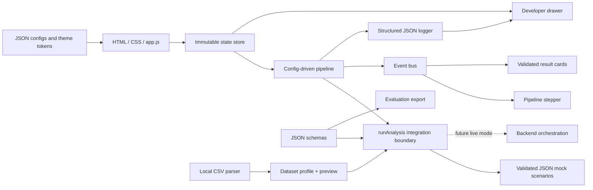

# AskBase — UI, Evaluation & Integration

A config-driven, responsive AskBase interface built with plain HTML, CSS, JavaScript ES modules, and a dependency-free Node.js server. The current release uses a clearly labelled **mock backend** and **baseline evaluation fixtures, not live measurements**.

## Run

Requires Node.js 20 or later. No package installation is needed.

```sh
cd agent4_ui-evaluation
npm start
```

Open `http://127.0.0.1:4173`.

On Windows, you can instead double-click `start.bat` to launch the server and open the site. Run `stop.bat` to stop only the server started by that script.

```sh
npm test
```

All **31 unit tests** pass, including the original 14 tests.

## What is included

- Cream-and-orange landing page with responsive CSS/SVG preview cards
- Analyze, Upload, Evaluation, and Docs navigation
- Sample retail schema explorer and data-quality warnings
- Seven configurable analysis scenarios with distinct success, clarification, empty, error, unsafe-SQL, and truncation states
- Five-stage animated pipeline with request-ID stale-response protection
- Answer, verification, SQL, table, and chart result stack
- CSV-first drag/drop and keyboard-accessible upload
- Local CSV parsing, delimiter detection, schema inference, null counts, and six-row preview
- SQLite file selection with metadata-only state
- Evaluation metrics with explicit denominators, filters, and validated JSON export
- Readable OpenAPI-style Docs page
- Developer drawer with raw JSON, pipeline timeline, structured logs, active config, and debug-bundle export

## Architecture



The UI does not implement SQL validation, query execution, profiling, or answer generation. Those remain backend responsibilities.

## File map

| Path | Responsibility |
|---|---|
| `index.html` | Semantic landing page, workspace, evaluation, Docs, and Developer drawer |
| `styles.css` | Responsive visual system and component styling |
| `app.js` | UI orchestration, rendering, uploads, evaluation, Docs, and telemetry |
| `analysis-service.js` | Asynchronous `runAnalysis(question, databaseConfig, options)` boundary |
| `dataset.js` | CSV parsing, delimiter detection, validation, schema inference, and request metadata |
| `evaluation.js` | Fixture-backed metrics and scenario filters |
| `server.mjs` | Static server with JSON content types, no-store cache headers, and traversal protection |
| `config/` | App, theme, scenarios, examples, sample schema, and evaluation fixtures |
| `schemas/` | Analysis response, dataset profile, and evaluation report contracts |
| `lib/validate.js` | Dependency-free nested schema validation |
| `lib/pipeline.js` | Ordered stages with events, status, and durations |
| `lib/event-bus.js` | UI event publication and subscription |
| `lib/state-store.js` | Immutable reducer updates and stale-request rejection |
| `lib/logger.js` | Bounded structured in-memory logs |
| `lib/config.js` | Theme application and JSON document loading |
| `docs/api-contract.json` | Proposed backend endpoint contract |
| `tests/` | Unit tests and downloadable CSV fixture |

## Configuration

- `app.config.json`: version, feature flags, upload/result limits, and pipeline stages
- `theme.tokens.json`: colours, typography, radii, shadows, and spacing applied as CSS variables
- `scenarios.json`: all seven mock response envelopes
- `examples.json`: grouped question suggestions
- `sample-db.schema.json`: sample tables, columns, and quality warnings
- `evaluation.fixtures.json`: thirteen baseline evaluation scenarios

## CSV upload contract

CSV is the primary format. Files up to 10 MB are processed locally and never sent to the demo server. The parser supports UTF-8 BOM, comma/semicolon/tab delimiters, quoted fields, escaped quotes, embedded delimiter characters, and multiline values.

Validation covers file type, empty files, size, missing data rows, blank headers, duplicate headers, and unterminated quotes. Profiles include column types and null counts.

Analysis remains disabled for uploaded datasets while `liveBackend` is false. `createDatasetRequest` already prepares `databaseConfig` and schema/file metadata for the unchanged asynchronous integration boundary.

## Backend integration

Replace the mock implementation in `analysis-service.js` without changing:

```js
runAnalysis(question, databaseConfig, options)
```

Every response is checked against `schemas/analysis-response.schema.json` before rendering. Contract failures produce a distinct **Malformed response** error rather than verified content. The legacy `row_count` field is also returned for the original workstream tests; new UI code uses `rowCount`.

`docs/api-contract.json` documents the proposed `POST /api/analyze`, `POST /api/datasets/profile`, `GET /api/schema`, and `GET /api/evaluation/report` contracts. These are not live routes in the mock build.

## Verification

- 31 unit tests pass
- Original 14 tests remain passing
- Browser checks cover verified analysis, five pipeline stages, Developer telemetry, CSV preview, disabled uploaded-data analysis, evaluation filtering, and four Docs endpoint cards
- No browser console errors were observed
- Responsive layouts include 44px mobile tap targets and reduced-motion support

## Changelog

### v2.0.0

- Rebuilt the visual system and landing experience
- Added JSON configuration, schemas, contract validation, pipeline, state store, event bus, and logger
- Added CSV-first upload profiles and delimiter/BOM support
- Added Docs and Developer views with debug export
- Preserved the integration boundary and all original tests
