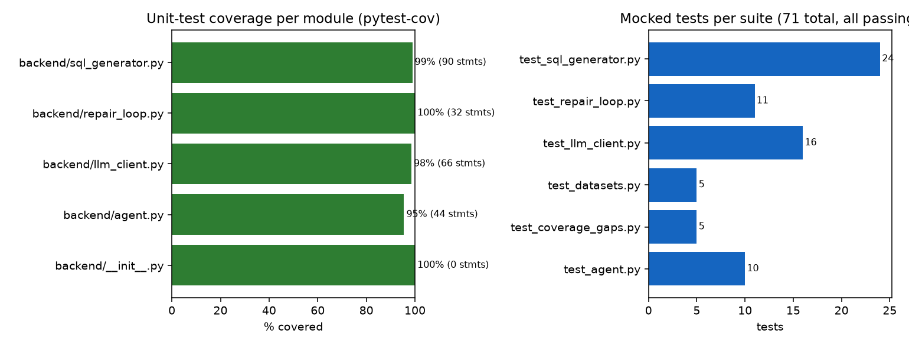
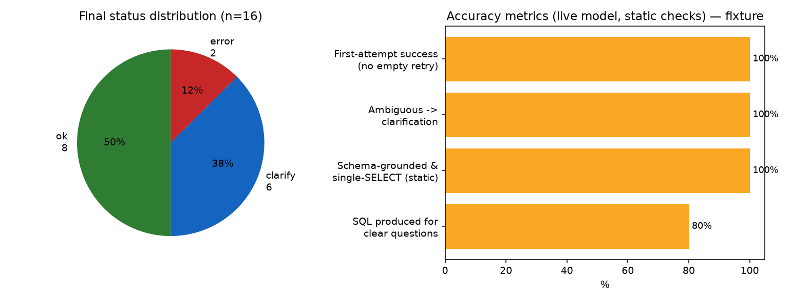
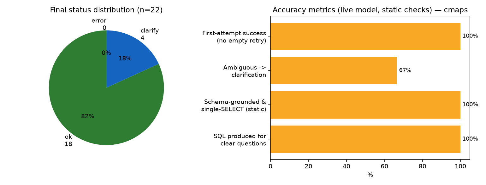
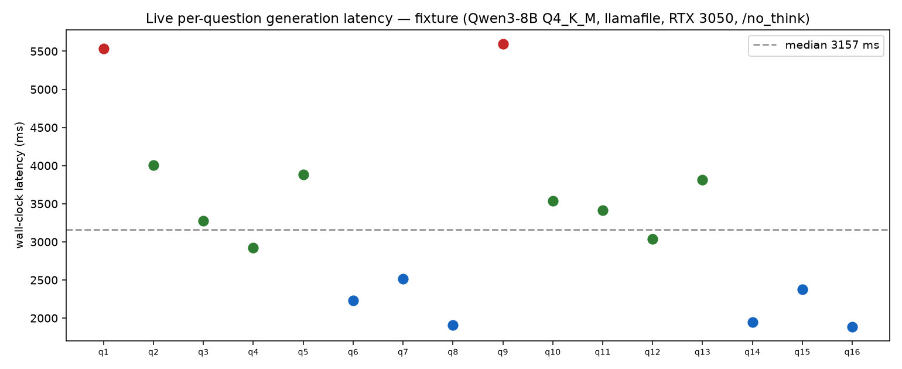
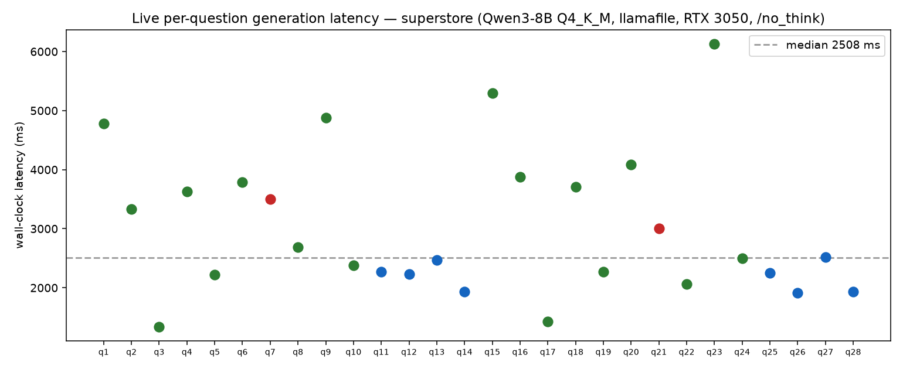
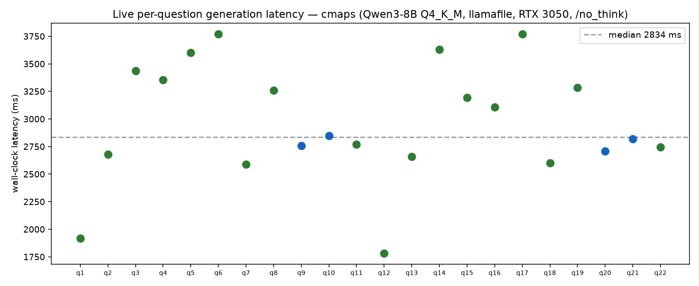

# AskBase — Agent 1 (AI Layer) Consolidated Work Report

Date: 2026-10-24 · Author: Agent 1 workstream (AI analyst & SQL generation)
Scope: everything under `ai-analyst/` — modules, prompts, tests, coverage, and live-model evaluation.

**Data honesty rules for this report.** Every number below is machine-recorded: test/coverage
figures come from `pytest --cov` / `coverage.json`, live figures come from `eval_results.csv`
written by `eval_live.py` against the real Qwen3 server. Charts are rendered by `make_charts.py`
from those same files — nothing is hand-entered. The accuracy metrics are **static checks**
(identifier guard + single-SELECT shape) applied to the generated SQL at generation time: the eval
harness never executed anything. Agent 3's SQLGlot validator has since merged (PR #3) and every
candidate now passes it plus read-only execution in the live gateway — but the figures below were
measured before that, so they are **not** execution-verified accuracy. Re-running the eval through
the gateway is outstanding work (see §7).

---

## 1. What the AI layer does

AskBase turns plain-English questions into verified SQL insights. Agent 1 owns the
intelligence layer: it interprets the question, generates **one read-only SQL candidate**
grounded in the provided schema, asks a clarifying question when the ask is materially
ambiguous, repairs invalid candidates within a hard budget, and — last — synthesizes a
short answer grounded strictly in real query results.

**Boundaries (enforced by tests):** generates SQL and language only; never connects to a
database, never executes SQL, never bypasses the injected validator, and never narrates an
answer when the model is offline or verification failed.

## 2. Architecture and data flow

```
                 ┌────────────────────────────────────────────────┐
 question ─────► │ sql_generator.generate_sql(question, schema)   │
 + schema        │   compact prompt (≤4096-token model) ──► LLM   │
                 │   parse JSON → status ok | clarification | err │
                 │   identifier guard (lexical, schema-grounded)  │
                 └───────────────┬────────────────────────────────┘
                                 │ candidate SQL
                 ┌───────────────▼────────────────────────────────┐
                 │ repair_loop.generate_validated_sql(…, validate)│
                 │   every candidate (initial + ≤2 repairs) goes  │
                 │   through Agent 3's injected validator.        │
                 │   invented_identifier / empty → re-prompt once │
                 │   within the same 2-repair budget; other errors│
                 │   surface immediately.                         │
                 └───────────────┬────────────────────────────────┘
                                 │ validated SQL (status ok) or error
                    execution + SQLGlot verification  ← AGENT 3 (not here)
                                 │ real rows
                 ┌───────────────▼────────────────────────────────┐
                 │ agent.synthesize_answer(question, sql, result) │
                 │   1–3 sentences from provided columns/rows only│
                 │   refuses on failed verification/execution     │
                 └────────────────────────────────────────────────┘

 llm_client.py sits underneath all of the above: env-configured OpenAI-compatible
 client (Qwen3-8B via llamafile), typed error mapping (offline / timeout / malformed).
```

## 3. Module reference

| Module | Public interface | Role | Mocked tests | Coverage |
|---|---|---|---|---|
| [`backend/llm_client.py`](backend/llm_client.py) | `chat_completion`, `complete_json`, `get_config` | env-configured endpoint access; tolerant JSON extraction; typed errors — no crash paths | 16 | 98% |
| [`backend/sql_generator.py`](backend/sql_generator.py) | `generate_sql(question, schema, prior_error=None) -> dict` | schema-aware generation + ambiguity → clarification + lexical identifier guard | 21 | 99% |
| [`backend/repair_loop.py`](backend/repair_loop.py) | `generate_validated_sql(question, schema, validate_sql, …, max_repairs=2)` | single execution path: every candidate through the same injected validator; ≤2 repairs | 11 (+2 gap tests) | 100% |
| [`backend/agent.py`](backend/agent.py) | `synthesize_answer(question, sql, result) -> dict` | grounded answer synthesis; empty-result is success; refuses unsupported answers | 10 | 95% |
| [`tests/test_coverage_gaps.py`](tests/test_coverage_gaps.py) | — | §3 edge cases: empty schema, malformed statuses, cap enforcement (3 tests; the other 2 gap tests exercise `repair_loop` above) | 5 | — |

All four modules return the shared envelope statuses `ok` / `clarification_needed` / `error`
(plus `success` / `refused` for synthesis) per the contract. No endpoint, model name, or key
is hardcoded anywhere — configuration is `LLM_BASE_URL`, `LLM_MODEL`, `LLM_API_KEY`,
`LLM_TIMEOUT_S`, `LLM_MAX_TOKENS`, `LLM_TEMPERATURE` (see [`.env.example`](../.env.example),
[ENDPOINT.md](ENDPOINT.md)).

## 4. Prompt design (summary — full reference in [PROMPTS.md](PROMPTS.md))

- **SQL generation system prompt:** ONLY schema-provided names; no invented currencies/units/
  periods. Material ambiguity → `clarification_needed` + one specific question, judged against
  four enumerated criteria (missing time period, unmapped metric, entity/join double meaning,
  aggregation basis). Immaterial choices (sort order, tie-break, limit, naming) → take a
  default and record it in `assumptions`. Output is a strict JSON object, with the JSON-only
  instruction placed last (8B models follow final-format instructions best).
- **Repair injection:** on `invented_identifier` or `empty`, the validator's real error message
  is appended verbatim (“Your previous attempt failed validation/execution with: …”).
  Transport errors never re-prompt the model.
- **Synthesis prompt:** 1–3 short plain-text sentences using ONLY provided columns/rows;
  explicitly forbids adding numbers, units, or comparisons not in the data.
- **Token budget:** server context is 4096 tokens; system ≈ 600 tok, schema block truncated at
  5000 chars ≈ 1300 tok, generation cap 1024 tok — headroom verified against the fixture schema.

## 5. Test suite & coverage (mocked — no model, no GPU)

71 mocked tests, 0 external services, ~0.5 s runtime — this satisfies the report §3
requirement of ≥15 mocked-LLM tests and runs in CI (grown from 60 → 71 with the Kaggle
dataset work below: 4 identifier-guard regression tests — implicit aliases, SQLite date
functions — and 3 dataset builder/question-set guards; coverage re-measured at 98%).

Requirement checklist from report §3 — “at least 15 mocked-LLM tests covering …”:

| Required area | Covering tests | File |
|---|---|---|
| Filters | `test_string_literals_do_not_count_as_identifiers` (WHERE region='West') | test_sql_generator |
| Joins | `test_join_with_aliases_passes_guard`, `test_valid_generation_returns_ok` | test_sql_generator |
| Aggregation | SUM/GROUP BY/ORDER BY/LIMIT in join + defaults tests | test_sql_generator |
| Ambiguity | `test_missing_time_period_returns_clarification`, `test_metric_not_in_schema_returns_clarification`, `test_clarification_never_leaks_sql`, `test_clarification_passthrough`, `test_clarification_without_question_is_error` | test_sql_generator |
| Invalid schema | `test_empty_schema_flags_all_identifiers_as_invented`, `test_schema_missing_optional_keys_is_tolerated` | test_coverage_gaps |
| Malformed output | `test_unknown_status_is_error`, `test_ok_status_without_sql_is_error`, client: non-JSON / missing choices / invalid / non-object JSON | test_sql_generator, test_llm_client |
| Offline server | `test_llm_offline_returns_error_dict`, client `test_connection_error_maps_to_offline`, synthesis `test_model_offline_returns_error_without_fabrication` | all three |
| Timeout | `test_llm_timeout_returns_error_dict`, client `test_timeout_maps_to_timeout` | generator, client |
| Repair limits | `test_repair_capped_at_two_then_error` (never a 4th), `test_invented_identifier_repair_stops_at_cap` | test_repair_loop, test_coverage_gaps |
| Empty results | `test_empty_result_is_success_not_error` (deterministic, model untouched) | test_agent |
| Insufficient evidence | `test_verification_mismatch_refused_even_with_rows`, `test_failed_verification_is_refused`, `test_failed_execution_is_refused` | test_agent |

Additional guarantees with dedicated tests: single-execution-path (every candidate through the same
injected validator), repair feedback carries the real validator error, clarification short-circuits,
schema context bounded for 4096-token model, no DB access anywhere in Agent 1 modules (source-scan guards).

**Semantic note (Part 8, ratified in INTEGRATION_CONTRACT.md §5.3):** `invented_identifier`
generation errors are treated as repairable (re-counted inside the ≤2 repair budget);
transport/malformed errors are not.



| Metric | Value |
|---|---|
| Tests passing | **71 / 71** (`pytest tests`, 2026-10-24) |
| Total statement coverage | **98%** (224/228) |
| Per-module | `repair_loop` 100% · `sql_generator` 99% · `llm_client` 98% · `agent` 95% |
| Source-scan guards | assert no DB-connection imports anywhere in Agent 1 modules |

## 6. Live-model evaluation (real Qwen3-8B, no mocks)

**Harness:** [`eval_live.py`](eval_live.py) pushes labeled questions through the real
`generate_sql()` against the local Qwen3-8B Q4_K_M llamafile server, `--repeats 2`, over
three datasets: the mini **fixture** (8 questions), Kaggle **Superstore** (14) and NASA
**C-MAPSS** (11). It records status, attempts, latency and static grounding checks to
[`eval_results.csv`](eval_results.csv). Metrics are **static checks** (identifier guard +
single-SELECT shape) recorded before Agent 3's SQLGlot validator merged, so they do not include
execution evidence.

> **The empty-completion problem is solved.** Earlier runs (n=12, thinking mode on) lost 4/12
> rows to intermittent empty completions at 25–98 s latency. Root cause confirmed with the
> server back up: Qwen3's *thinking tokens* consumed the whole 1024-token budget
> (`content:""`, `finish_reason:"length"`, reasoning text filled). Fix: the `/no_think` soft
> switch in both system prompts — a client-side change, no server flag needed. Result across
> all **66 new rows: 0 empty completions, median latency ~2.8 s (13× faster)**. The superseded
> n=12 run was removed from `eval_results.csv` (preserved in git history).

### Results (runs `202610dT1324Z`/`1326Z`, n=66, /no_think)

| Dataset | n | SQL for clear Qs | Grounded & single-SELECT | Ambiguous → clarify | Errors | Latency (s) min/med/max |
|---|---|---|---|---|---|---|
| fixture | 16 | 8/10 (80%) | **8/8 (100%)** | **6/6 (100%)** | 2 | 1.9 / 3.2 / 5.6 |
| superstore | 28 | 18/20 (90%) | **18/18 (100%)** | **8/8 (100%)** | 2 | 1.3 / 2.5 / 6.1 |
| cmaps | 22 | 16/16 (100%) | **18/18 (100%)** | 4/6 (67%) | 0 | 1.8 / 2.8 / 3.8 |
| **total** | **66** | **42/46 (91%)** | **44/44 (100%)** | **18/20 (90%)** | 4 | median 2.8 |

Zero false clarifies on clear questions in any dataset; zero empty-completion retries needed.





**Latency scatter (per dataset):**





### Analysis — every failure, named

- **fixture, 2 errors** (same question both repeats): model emitted `products.price`, which
  does not exist in the fixture schema → **identifier guard correctly rejected it**
  (`invented_identifier`). The guard working, not failing.
- **superstore, 2 errors** (same question both repeats): model emitted Postgres-style
  `EXTRACT(YEAR FROM order_date)` → rejected as unknown identifier. SQLite needs
  `strftime('%Y', …)`. Deterministic dialect slip; a repair-loop pass with this error message
  would likely fix it — good Gate 5 demo.
- **cmaps, 2 clarification misses** (same question both repeats): “How many engines are
  unhealthy?” was answered with `true_rul_cycles < 100` instead of clarifying — the model
  invented a threshold silently. This is the known 8B-judgment limitation (§7.4), and it is
  *visible* because the question set is labeled.
- All 44 accepted SQL outputs used only schema identifiers in a single SELECT — including
  alias-aware multi-table joins over the 4-table Superstore FK graph and the 26-column
  C-MAPSS telemetry table.

### Test datasets upgraded to real Kaggle data

`datasets/build_datasets.py` (stdlib-only) normalizes the two downloaded Kaggle
datasets into SQLite: **Superstore** (9800 rows → customers/products/orders/
line_items; DD/MM/YYYY dates verified) and **NASA C-MAPSS** FD001–FD004
(265,256 telemetry rows + 707 true-RUL rows). `datasets/question_sets.py` labels
14 + 11 questions with **sqlite-computed ground truths** (e.g. West region leads
with $744,293.55; 119 test engines have RUL < 20 cycles) so Agent 4 can score
generated SQL by result, not just static shape. Building these sets also surfaced
and fixed two identifier-guard false positives (implicit `SUM(x) alias`; SQLite
functions like `julianday`), now pinned by regression tests (suite: 63 → **71**).

### Earlier live smoke evidence (Part 9, [RESULTS.md](RESULTS.md))

First live probe on 2026-10-24: 4/5 generation attempts ok (1 empty → succeeded on retry),
clarification correct on the real model, and synthesis **refused** to answer a deliberately
mismatched SQL/result pair — verbatim: “The result provided does not answer the question…”
That refusal is the §3 honesty property demonstrated on the live model.

## 7. Findings & known limitations (honest list)

1. ~~Empty completions are the dominant live failure mode~~ **RESOLVED**: root cause was
   Qwen3 thinking tokens consuming the generation budget; `/no_think` in both system prompts
   eliminated it (0/66 rows) and cut latency ~13×. The P2a empty-retry stays as cheap insurance.
   The P3 KV-cache flag experiment is now optional polish, not a fix.
2. **Latency is now 1.3–6.1 s/question** on RTX 3050 6 GB — interactive-UI-friendly; the
   “design around 40 s” guidance to Agent 4 is superseded.
3. **The identifier guard is lexical**: a fabricated table name colliding with a real column
   elsewhere passes it. Agent 3's SQLGlot parse is the real boundary — hence the contract rule
   that *nothing* reaches execution except validator-approved SQL. (It did catch both real
   invented-identifier failures in §6, and the guard's own false positives are now fixed.)
4. **Ambiguity detection quality depends on the 8B model's judgment**: it answered
   “how many engines are unhealthy?” with a silently invented threshold (RUL < 100) instead
   of clarifying — 2/20 labeled-ambiguous cases. Mocked tests pin our handling, not the
   model's judgment; consider a prompt tweak listing “unhealthy/at-risk” style undefined
   adjectives as clarify triggers.
5. **4096-token context caps schema size** (5000-char truncation); Agent 2 must keep schema
   summaries compact for wide databases (the 26-column C-MAPSS schema fits with generic names).
6. Sample: 66 live rows across 3 datasets, 2 repeats; repeat-level agreement was 100% —
   every failure repeated identically, so percentages are stable but sample-small.
7. Single dialect (`sqlite`) tested; the two superstore errors were the model reaching for
   Postgres syntax (`EXTRACT`) — repair-loop feedback is the intended remedy at Gate 5.

## 8. Team status & next steps

- **Gate 2 ([`INTEGRATION_CONTRACT.md`](../INTEGRATION_CONTRACT.md))**: interfaces and status
  vocabulary proposed and implemented on Agent 1's side; sign-off table still awaiting
  Agents 2–4.
- **Agent 2 has landed** `sample_data/` (messy SQLite fixture + tests, merged as `cdbac60`) —
  next AI-side step is re-running `eval_live.py` against that real schema via Agent 3's
  SQLGlot validator through `generate_validated_sql` (Gate 5: safety path end-to-end).
- **Agent 3**: inject validator into `repair_loop` (contract §3 gives the exact callable
  signature; `REPAIRABLE_ERROR_TYPES = {invented_identifier, empty}` semantics agreed).
- **Agent 4**: wire the end-to-end flow per [HANDOFF.md](HANDOFF.md) §“For Agent 4”.
- Queued infra items: P3 latency experiment (needs server restart with flag variant); CI
  commits and repo rename await PAT scope upgrades.

## 9. Reproduce everything

```bash
cd ai-analyst
../.venv/Scripts/python.exe -m pytest tests --cov=backend --cov-report=term   # 71 tests, 98%
# live eval (requires: repo root → start_server.bat):
../.venv/Scripts/python.exe datasets/build_datasets.py        # rebuild SQLite datasets once
for d in fixture superstore cmaps; do
  ../.venv/Scripts/python.exe eval_live.py --dataset $d --repeats 2
  ../.venv/Scripts/python.exe make_charts.py $d               # rebuilds report_assets/*.png
done
```

*Sources: [`coverage.json`](coverage.json) (2026-10-24), [`eval_results.csv`](eval_results.csv)
(runs `202610dT1324Z`/`202610dT1326Z`, 66 rows across fixture/superstore/cmaps),
[RESULTS.md](RESULTS.md) (Part 9 probes).*
