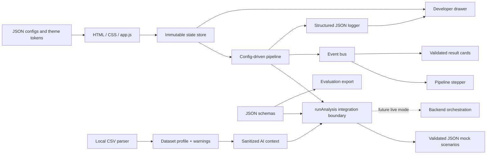

# AskBase — UI, Evaluation & Integration

A config-driven, responsive AskBase interface built with plain HTML, CSS, JavaScript ES modules, and a dependency-free Node.js server. CSV profiling runs locally in the browser. The analysis provider remains clearly labelled **mock backend** and evaluation values are **baseline evaluation fixtures, not live measurements**.

## Run

Requires Node.js 20 or later. No package installation is needed.

```sh
cd ui-evaluation
npm start
```

Open `http://127.0.0.1:4173`.

On Windows, you can instead double-click `start.bat` to launch the server and open the site. Run `stop.bat` to stop only the server started by that script.

```sh
npm test
```

All **36 unit tests** pass, including the original 14 tests.

## What is included

- Cream-and-orange landing page with responsive CSS/SVG preview cards
- Analyze, Upload, Evaluation, and Docs navigation
- Sample retail schema explorer and data-quality warnings
- Seven configurable analysis scenarios with distinct success, clarification, empty, error, unsafe-SQL, and truncation states
- Five-stage animated pipeline with request-ID stale-response protection
- Answer, verification, SQL, table, and chart result stack
- CSV-first multi-file drag/drop and keyboard-accessible upload
- Local CSV parsing, delimiter detection, schema inference, null/distinct/duplicate counts, type validation, numeric/date statistics, warnings, and six-row preview
- SQLite file selection with metadata-only state
- Evaluation metrics with explicit denominators, filters, and validated JSON export
- Readable OpenAPI-style Docs page
- Developer drawer with raw JSON, pipeline timeline, structured logs, active config, and debug-bundle export

## Architecture



The UI performs bounded browser-local CSV profiling only. It does not implement SQL validation or query execution. Uploaded-data analysis is passed through the existing mock boundary until a live backend is connected.

## File map

| Path | Responsibility |
|---|---|
| `index.html` | Semantic landing page, workspace, evaluation, Docs, and Developer drawer |
| `styles.css` | Responsive visual system and component styling |
| `app.js` | UI orchestration, rendering, uploads, evaluation, Docs, and telemetry |
| `analysis-service.js` | Asynchronous `runAnalysis(question, databaseConfig, options)` boundary |
| `dataset.js` | Multi-file CSV validation, parsing, profiling, privacy-aware AI context, and request metadata |
| `evaluation.js` | Fixture-backed metrics and scenario filters |
| `server.mjs` | Static server with JSON content types, no-store cache headers, and traversal protection |
| `start.bat` / `stop.bat` | Windows launcher, browser opening, and PID-scoped server shutdown |
| `config/` | App, theme, scenarios, examples, sample schema, and evaluation fixtures |
| `schemas/` | Analysis response, dataset profile, and evaluation report contracts |
| `lib/validate.js` | Dependency-free nested schema validation |
| `lib/pipeline.js` | Ordered stages with events, status, and durations |
| `lib/event-bus.js` | UI event publication and subscription |
| `lib/state-store.js` | Immutable reducer updates and stale-request rejection |
| `lib/logger.js` | Bounded structured in-memory logs |
| `lib/config.js` | Theme application and JSON document loading |
| `docs/api-contract.json` | Proposed backend endpoint contract |
| `tests/` | Unit tests and downloadable CSV fixture |

## Configuration

- `app.config.json`: version, feature flags, upload/result limits, and pipeline stages
- `theme.tokens.json`: colours, typography, radii, shadows, and spacing applied as CSS variables
- `scenarios.json`: all seven mock response envelopes
- `examples.json`: grouped question suggestions
- `sample-db.schema.json`: sample tables, columns, and quality warnings
- `evaluation.fixtures.json`: thirteen baseline evaluation scenarios

## CSV upload and profiling contract

CSV is the primary format. Files up to 10 MB, 100,000 rows, and 100 columns are processed locally and stay in the browser (the gateway's ingest endpoint caps uploads at its `MAX_CSV_BYTES`, 5 MB). The parser supports UTF-8 BOM, comma/semicolon/tab delimiters, quoted fields, escaped quotes, embedded delimiter characters, and multiline values.

Validation covers extension/MIME, empty files, size, row and column limits, missing data rows, blank headers, duplicate headers, invalid UTF-8, malformed CSV, and unterminated quotes. Profiles include legacy `NUMBER`/`DATE`/`TEXT` fields plus logical `integer`, `decimal`, `boolean`, `date`, `datetime`, `mixed`, `string`, and `unknown` types; nulls, distinct values, duplicate rows, invalid values, whitespace/case inconsistencies, numeric/date statistics, identifier hints, and sensitive-field hints.

Click **Profile data** after selecting one or more files. The profile is shown with summary cards and expandable column details. Warnings use `warning` status; parse/profile failures use `error` status and never render as successful profiling. Files can be removed individually or cleared as a group.

The generated `aiContext` contains table/column metadata, bounded aggregates, warnings, and up to three non-sensitive samples per column. It excludes full CSV text, filesystem paths, credentials, and samples for likely sensitive columns such as email, phone, address, password, token, bank, or account fields.

With the live gateway, only server-side data is analyzable: the bundled sample and a registered gateway dataset. A single locally parsed CSV is ingested on demand — **Ingest into gateway** posts the text to `POST /api/datasets/upload`, which rebuilds it server-side as SQLite under `gateway/uploads/` and returns its registered id; the preview then switches to that dataset. Nothing is uploaded until the user chooses it, and `createDatasetRequest` keeps addressing datasets by registered id. Without the gateway, a profiled CSV can be analyzed through the mock boundary.

## Backend integration

Replace the mock implementation in `analysis-service.js` without changing:

```js
runAnalysis(question, databaseConfig, options)
```

`runAnalysis(question, databaseConfig, options)` receives `options.aiContext` for uploaded datasets. The mock response is marked `meta.mode = "mock"`, `meta.aiContextReceived = true`, and `verification.passed = false`; the UI labels it **Mock analysis preview** / **Mock only**. No uploaded-data response is presented as live AI or verified SQL. Every response is checked against `schemas/analysis-response.schema.json` before rendering. Contract failures produce a distinct **Malformed response** error. The legacy `row_count` field remains returned for the original workstream tests; new UI code uses `rowCount`.

`docs/api-contract.json` documents the proposed `POST /api/analyze`, `POST /api/datasets/profile`, `GET /api/schema`, and `GET /api/evaluation/report` contracts. These are not live routes in the mock build.

## Verification

- 36 unit tests pass
- Original 14 tests remain passing
- Browser checks cover verified sample analysis, local CSV profiling, mock profile-context analysis, five pipeline stages, Developer telemetry, evaluation filtering, and Docs endpoint cards
- No browser console errors were observed
- Exact 1440px and 390px screenshots for the hero, verified workspace, CSV preview, evaluation, and Developer panel are in `screenshots/`
- Responsive layouts include 44px mobile tap targets and reduced-motion support

## Changelog

### v2.0.0

- Rebuilt the visual system and landing experience
- Added JSON configuration, schemas, contract validation, pipeline, state store, event bus, and logger
- Added CSV-first upload profiles and delimiter/BOM support
- Added Docs and Developer views with debug export
- Preserved the integration boundary and all original tests
